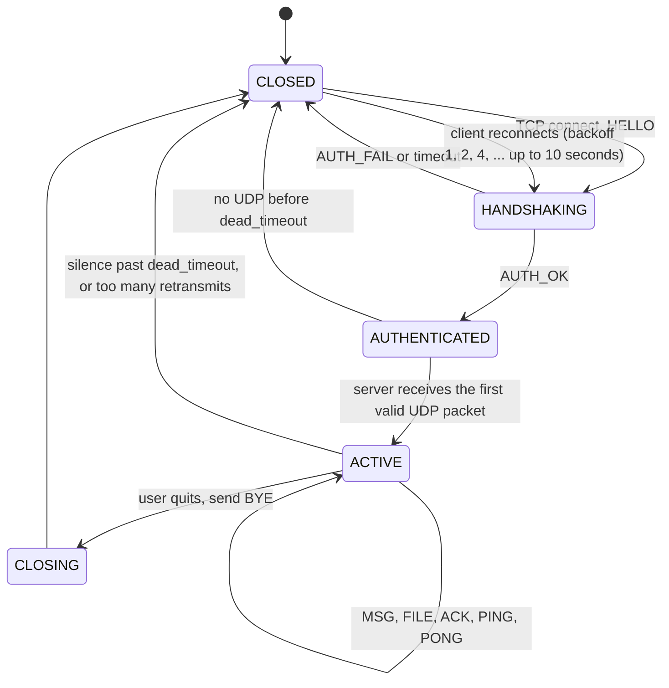
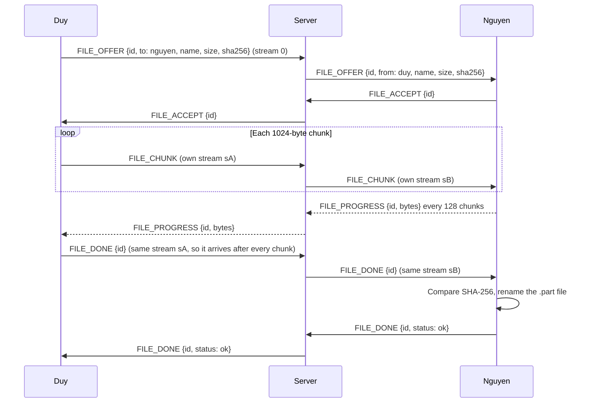

# StreamLink protocol specification v1

This document describes the application protocol StreamLink uses for chat and file transfer. The protocol runs on two channels:

- **TCP** (default port `9000`) is used only for the handshake: greeting, key exchange, and login. The TCP connection closes as soon as login finishes.
- **UDP** (default port `9001`) carries everything else. Reliability, ordering, flow control, and congestion control are provided by a custom **RUDP** (Reliable UDP) layer.

All integers are big-endian (network byte order).

## 1. Packet format

The same packet layout is used for TCP (handshake) and UDP. On TCP, `payload_len` is the framing field: the receiver reads exactly 27 header bytes, then `payload_len` more bytes.

```
 0               1               2               3
 0 1 2 3 4 5 6 7 0 1 2 3 4 5 6 7 0 1 2 3 4 5 6 7 0 1 2 3 4 5 6 7
+-------------------------------+---------------+---------------+
|          magic = 0x534C       |   version=1   |     type      |
+---------------+---------------+---------------+---------------+
|     flags     |                  session_id (32)              |
+---------------+-----------------------------------------------+
|               |                  stream_id (32)               |
+---------------+-----------------------------------------------+
|               |                     seq (32)                  |
+---------------+-----------------------------------------------+
|               |                     ack (32)                  |
+---------------+-----------------------------------------------+
|               |                 sack_bitmap (32)              |
+---------------+-------------------------------+---------------+
|               |      payload_len (16)         |   payload ... |
+---------------+-------------------------------+---------------+
```

| Field | Size | Meaning |
| --- | --- | --- |
| `magic` | 2 bytes | Always `0x534C` ("SL"). A packet with the wrong magic is dropped. |
| `version` | 1 byte | Protocol version, currently `1`. |
| `type` | 1 byte | Packet type (section 2). |
| `flags` | 1 byte | Flags (section 3). |
| `session_id` | 4 bytes | Session id assigned by the server in HELLO. The server uses it to find the connection and the decryption key. |
| `stream_id` | 4 bytes | Stream this packet belongs to. Stream `0` is control and chat; each file transfer has its own stream. |
| `seq` | 4 bytes | Sequence number of the packet **within the stream**, increasing monotonically from 0. |
| `ack` | 4 bytes | Used only in `ACK`: the smallest sequence number the receiver has **not** received yet (cumulative ACK). |
| `sack_bitmap` | 4 bytes | Used only in `ACK`: bit `i` set means packet `ack + 1 + i` has been received (selective ACK). |
| `payload_len` | 2 bytes | Length of the payload that follows. |

The header is **27 bytes**. A UDP datagram is at most **1200 bytes** so it is not fragmented at the IP layer. The UDP payload is always encrypted:

```
payload = nonce (12 bytes) || ciphertext || tag (16 bytes)
```

The maximum plaintext in one datagram is therefore `1200 - 27 - 28 = 1145` bytes. RUDP splits a message into fragments of at most **1100 bytes**.

## 2. Packet types

| Code | Name | Channel | Reliable | Payload | Description |
| --- | --- | --- | --- | --- | --- |
| `0x01` | `ACK` | UDP | No | empty | Acknowledges packets of one stream (`ack` + `sack_bitmap`). |
| `0x02` | `PING` | UDP | No | send-time `double` | Heartbeat and RTT sample. |
| `0x03` | `PONG` | UDP | No | echoes the `PING` payload | Heartbeat reply. |
| `0x04` | `BYE` | UDP | No | JSON `{reason}` | Clean shutdown, sent twice. |
| `0x10` | `HELLO` | TCP | (TCP) | JSON | Greeting and X25519 key exchange. |
| `0x11` | `AUTH` | TCP | (TCP) | JSON, encrypted | Username and password. |
| `0x12` | `AUTH_OK` | TCP | (TCP) | JSON, encrypted | Login succeeded, includes the user list. |
| `0x13` | `AUTH_FAIL` | TCP | (TCP) | JSON, encrypted | Login failed, with a reason. |
| `0x20` | `LIST` | UDP | Yes | JSON | Request or return the list of active users. |
| `0x21` | `PRESENCE` | UDP | Yes | JSON | A user joined or left. |
| `0x22` | `MSG_ALL` | UDP | Yes | JSON | Broadcast chat message. |
| `0x23` | `MSG_DM` | UDP | Yes | JSON | Direct (unicast) message. |
| `0x30` | `FILE_OFFER` | UDP | Yes | JSON | Offer to send a file. |
| `0x31` | `FILE_ACCEPT` | UDP | Yes | JSON | Receiver accepts. |
| `0x32` | `FILE_REJECT` | UDP | Yes | JSON | Receiver or server rejects. |
| `0x33` | `FILE_CHUNK` | UDP | Yes | binary | One file data chunk. |
| `0x34` | `FILE_DONE` | UDP | Yes | JSON | Sender reports the last chunk; receiver reports the SHA-256 result. |
| `0x35` | `FILE_PROGRESS` | UDP | Yes | JSON | Receiver reports bytes written (end-to-end flow control). |
| `0x36` | `FILE_CANCEL` | UDP | Yes | JSON | Cancel a transfer (for example a peer disconnected). |
| `0x3F` | `ERROR` | UDP | Yes | JSON | Application error (peer offline, bad JSON, ...). |

Rule: every type with code `>= 0x20` is a **reliable message** and travels on an RUDP stream. Types `< 0x10` are transport control packets and are not retransmitted.

## 3. Flags

| Bit | Name | Meaning |
| --- | --- | --- |
| `0x01` | `FIN` | Last fragment of a message. |
| `0x02` | `FRAG` | Middle fragment; more fragments follow. |
| `0x04` | `ACK` | `ack` / `sack_bitmap` are meaningful (set on `ACK` packets). |
| `0x08` | `RETX` | This packet is a retransmission. Statistics and debugging only. |
| `0x10` | `ENC` | Payload is encrypted (always set on UDP and on `AUTH*`). |

A small application message that fits in one packet carries `FIN`. A message larger than 1100 bytes is split into consecutive packets on the same stream: earlier packets carry `FRAG`, the last carries `FIN`. The receiver reassembles fragments in `seq` order and delivers the message only when it sees `FIN`.

## 4. Handshake and login (TCP)

```mermaid
sequenceDiagram
    participant C as Client
    participant S as Server
    C->>S: TCP connect :9000
    C->>S: HELLO {version, pub: client X25519}
    S->>C: HELLO {session_id, pub: server X25519, udp_port}
    Note over C,S: Both sides derive the ECDH shared secret; HKDF-SHA256 produces c2s and s2c keys
    C->>S: AUTH (encrypted) {username, password}
    S->>S: Check PBKDF2, create Session and RUDP connection
    S->>C: AUTH_OK (encrypted) {username, users, heartbeat}
    C--xS: Close TCP
    C->>S: UDP PING (session_id, encrypted)
    S->>S: Record UDP address, session becomes ACTIVE
    S->>C: UDP PONG, LIST
    S-->>S: PRESENCE join to the other clients
```

Payloads:

- `HELLO` (client to server): `{"version": 1, "pub": "<base64 32 bytes>"}`
- `HELLO` (server to client): `{"session_id": 123, "pub": "<base64>", "udp_port": 9001}`; the header also carries `session_id`.
- `AUTH`: `{"username": "duy", "password": "..."}`. The payload is `nonce || AES-GCM(ciphertext)` with the 27-byte header as AAD.
- `AUTH_OK`: `{"username": "duy", "session_id": 123, "udp_port": 9001, "heartbeat": 3.0, "users": [...]}`
- `AUTH_FAIL`: `{"reason": "invalid credentials"}`

A valid username matches `^[A-Za-z0-9_.-]{1,32}$`. If the account does not exist and registration is allowed (the default), the server creates it. Passwords are stored as salted PBKDF2-HMAC-SHA256. If the same account logs in again, the previous session is closed with reason `replaced`.

Each handshake stage times out after 10 seconds. The server closes the TCP connection if the client is silent or sends a bad packet.

## 5. Connection state



## 6. RUDP

### 6.1. Streams and head-of-line blocking

Each side has its own **send streams**, numbered from 0. Stream `0` carries control and chat (which must stay in order). Each file transfer opens a new stream. Order is guaranteed **only within one stream**: a lost file packet stalls only that file stream; chat on stream 0 is still delivered. This is how QUIC avoids TCP head-of-line blocking.

The sender schedules streams as follows: stream 0 is always preferred, and the remaining streams share the rest of the turns (round-robin). Chat therefore does not queue behind thousands of file chunks.

### 6.2. Sequence numbers, ACK, and SACK

- Each stream starts `seq` at 0 and increments by 1 per packet.
- The receiver keeps `expected` (the next sequence number to deliver) and a reorder buffer for packets that arrive early.
- A duplicate (`seq < expected`, or already in the buffer) is dropped, but still triggers an immediate ACK (the previous ACK may have been lost).
- An ACK carries `ack = expected` and a `sack_bitmap` covering the next 32 packets. An ACK is sent immediately when there is a hole (an out-of-order arrival) or after every 2 packets; otherwise it is delayed by at most 10 ms.

### 6.3. Selective retransmission

The sender keeps unacknowledged packets, ordered by the most recent send time. **Only missing packets are retransmitted**:

- **Fast retransmit:** if at least 3 packets with a higher `seq` have been SACKed while a packet is still missing, and at least 1 RTT has passed since it was last sent, it is sent again immediately.
- **Time-based loss detection (RACK-style, RFC 8985):** the sender remembers the send time of the newest acknowledged packet (`rack_sent`). An unacknowledged packet that was sent *before* that time, and that is older than `SRTT + max(SRTT/4, 2 ms)`, is treated as lost and retransmitted. This still works when the window is too small to produce 3 SACKs (for example a loss at the end of a burst), so the sender does not have to wait for the RTO.
- **Timeout (RTO):** a packet still unacknowledged after `RTO` is retransmitted; the RTO doubles (exponential backoff, capped at 3 seconds).
- RTO follows Jacobson/Karels: `SRTT`, `RTTVAR`, `RTO = SRTT + 4 * RTTVAR`, clamped to `[200 ms, 3 s]`. Karn's algorithm does not sample RTT from a retransmitted packet. The 200 ms floor (as on Linux) avoids spurious timeouts when the path has jitter and the receiver delays ACKs.
- A packet retransmitted more than 15 times kills the connection.

### 6.4. Sliding window (flow control)

The receiver accepts only packets with `expected <= seq < expected + 1024`. The sender likewise does not send a packet with `seq >= base + 1024`, where `base` is the highest cumulative ACK of the stream. The receiver's buffer therefore never holds more than 1024 packets per stream.

File transfer through the server also has an **end-to-end** window at the application layer: the sender may run at most 512 KB ahead of the byte count the receiver has reported in `FILE_PROGRESS`. That stops the server from buffering without bound when the receiver is slower than the sender.

### 6.5. Congestion control

Each connection has a congestion window `cwnd` (in packets) that limits packets in flight across all streams. The default is **CUBIC**; **NewReno** is selected with `--cc reno`:

- Slow start: `cwnd += 1` per acknowledged packet until `ssthresh`. Initial `cwnd = 10`, minimum 4, maximum 2048.
- CUBIC: `W(t) = C * (t - K)^3 + W_max`, with `C = 0.4`, `K = cbrt(W_max * (1 - beta) / C)`, `beta = 0.7`. A *TCP-friendly region* keeps the window at least as large as the Reno estimate `W_est`, so CUBIC is not slower than Reno at small RTTs.
- NewReno: congestion avoidance adds `1/cwnd` per ACK; on loss, `cwnd = cwnd / 2`.
- On loss (fast retransmit or RACK): `W_max = cwnd`, `cwnd = cwnd * 0.7`. The window is reduced only once per loss episode (packets sent after the previous reduction).
- On timeout: `ssthresh = cwnd * 0.7`, `cwnd = 4` (the minimum). Keeping at least 4 packets in flight means SACKs can still be generated, instead of collapsing to 1–2 packets where every loss waits for an RTO.

### 6.6. Heartbeat and dead-peer detection

- Each side sends `PING` every 3 seconds; the other replies with `PONG` carrying the same payload, which measures RTT.
- Right after login the client sends `PING` every 250 ms until the first packet from the server arrives (so the server learns the UDP address quickly).
- If no valid packet arrives for 10 seconds, the connection closes with reason `timeout`. The server drops the session, sends `PRESENCE leave`, and cancels related file transfers. The client enters `reconnecting` and tries again.
- The client's UDP address is updated from the latest valid packet, so a client that changes port (for example through NAT) keeps working.

## 7. Security

- **Key exchange:** X25519 ECDH inside `HELLO`. The key is derived with HKDF-SHA256 (`salt = session_id`, `info = "streamlink/1" || pub_client || pub_server`) into 64 bytes: the first 32 are the client-to-server key, the next 32 are the server-to-client key.
- **Encryption:** AES-256-GCM for every UDP payload (including `ACK` and `PING`) and for `AUTH`, `AUTH_OK`, `AUTH_FAIL`. The 27-byte header is AAD, so an attacker cannot change `seq`, `ack`, or `session_id` without detection.
- **Nonce:** 12 bytes = 4 zero bytes and an 8-byte counter that increases per direction. Each retransmission is encrypted under a new nonce, so a nonce is never reused with the same key.
- A packet that fails to decrypt is dropped and counted in `decrypt_failures`.
- The password travels only on the encrypted channel and is stored as PBKDF2-HMAC-SHA256 (100,000 iterations, 16-byte salt).

Known limit: the server's public key is not authenticated (there is no PKI), so the protocol resists passive eavesdropping and does not resist an active man-in-the-middle.

## 8. Application messages

JSON payloads are UTF-8.

### 8.1. Users and presence

- Client to server `LIST`: `{}`
- Server to client `LIST`: `{"users": [{"username": "duy", "ip": "127.0.0.1", "port": 50123, "since": 1730800000.0}]}`
- Server to client `PRESENCE`: `{"event": "join" | "leave", "user": {...}, "reason": "timeout"}`

### 8.2. Messages

- Client to server `MSG_ALL`: `{"text": "hello", "cid": "c-12"}`
- Client to server `MSG_DM`: `{"to": "nguyen", "text": "hi", "cid": "c-13"}`
- Server to clients `MSG_ALL` / `MSG_DM`: `{"id": 42, "from": "duy", "to": "nguyen", "text": "...", "ts": 1730800000.5, "cid": "c-13"}`

The server echoes a message back to the sender so the sender knows it was relayed and every client shows the same order. `cid` lets the sender match a pending message with that echo. `text` is at most 4000 characters. If the recipient is offline, the server returns `ERROR {"code": "user_offline", "to": "nguyen", "cid": "c-13"}`.

### 8.3. File transfer



`FILE_CHUNK` binary payload:

```
transfer_id (16 bytes, UUID) || offset (8 bytes, uint64) || data (at most 1024 bytes)
```

- `FILE_OFFER`: `{"id": "<32 hex>", "to": "nguyen", "name": "report.pdf", "size": 123456, "sha256": "<64 hex>"}`. Maximum size is 2 GiB.
- `FILE_REJECT`: `{"id": "...", "reason": "user_offline"}`
- `FILE_PROGRESS`: `{"id": "...", "bytes": 131072}`
- `FILE_DONE` from the sender: `{"id": "..."}`; from the receiver: `{"id": "...", "status": "ok" | "corrupt", "sha256": "..."}`
- `FILE_CANCEL`: `{"id": "...", "reason": "peer disconnected"}`

The server forwards chunks only for an accepted transfer and only from the real sender. The receiver writes each chunk at `offset` into a `.part` file, updates a running SHA-256, and renames the file only when the hash matches.

## 9. Default constants

| Parameter | Value |
| --- | --- |
| Maximum datagram | 1200 bytes |
| Maximum message fragment | 1100 bytes |
| File chunk | 1024 bytes |
| Receive window per stream | 1024 packets |
| End-to-end file window | 512 KB |
| Initial, minimum, maximum RTO | 500 ms, 200 ms, 3 s |
| Initial, minimum, maximum `cwnd` | 10, 4, 2048 packets |
| Maximum retransmissions | 15 |
| Heartbeat period | 3 s |
| Dead-connection timeout | 10 s |
| Delayed ACK | 10 ms |
