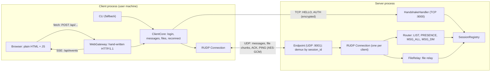
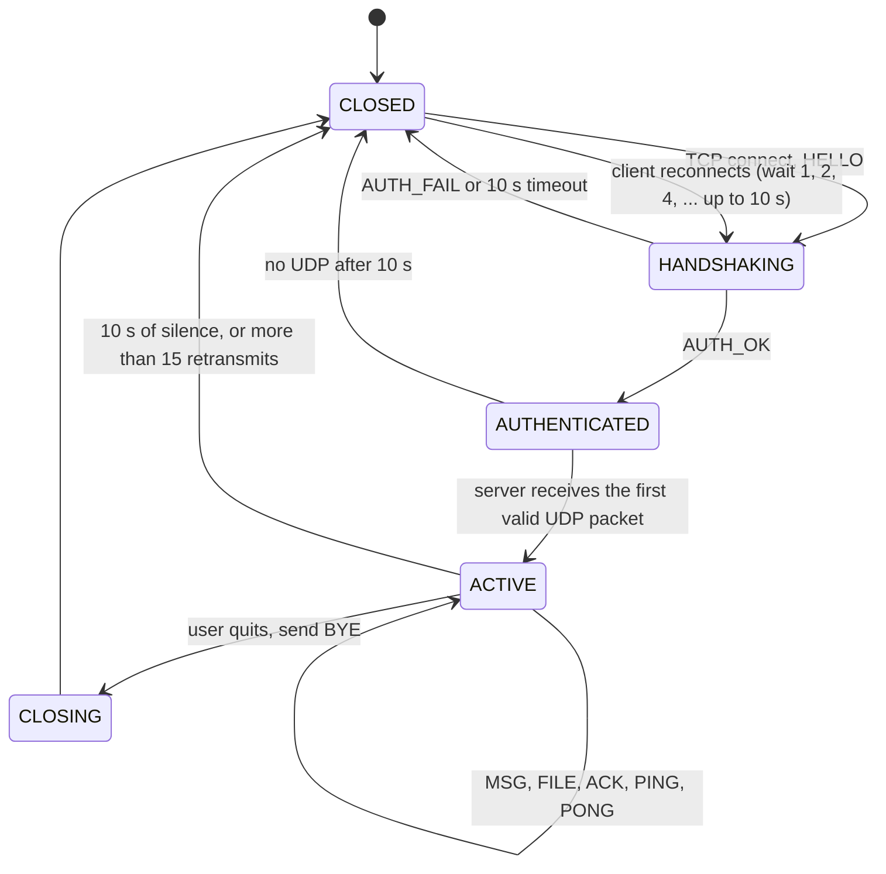
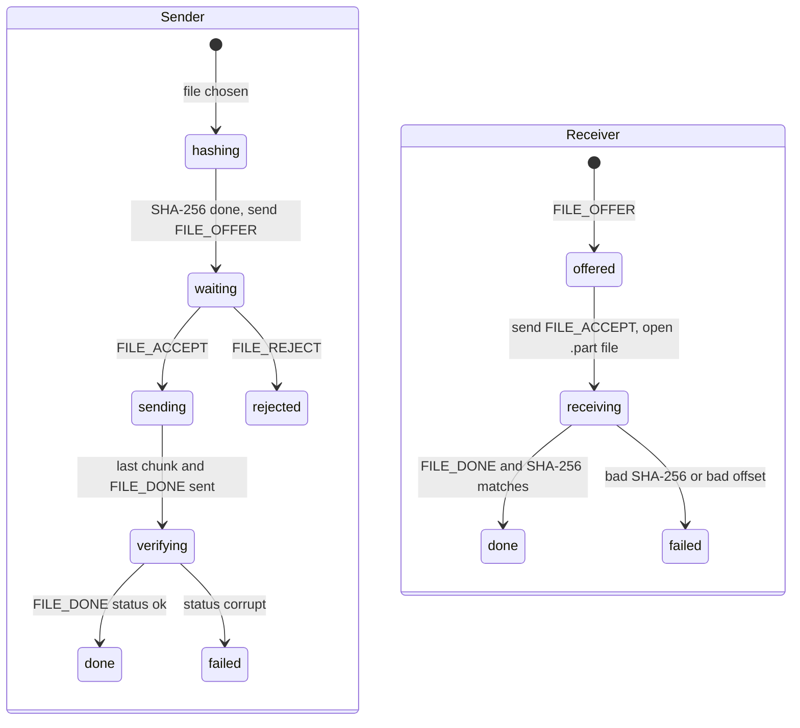
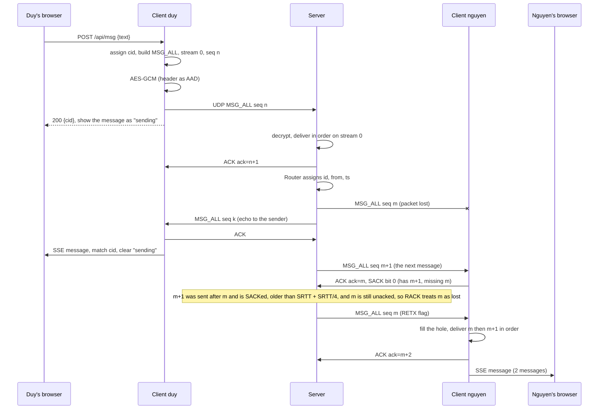
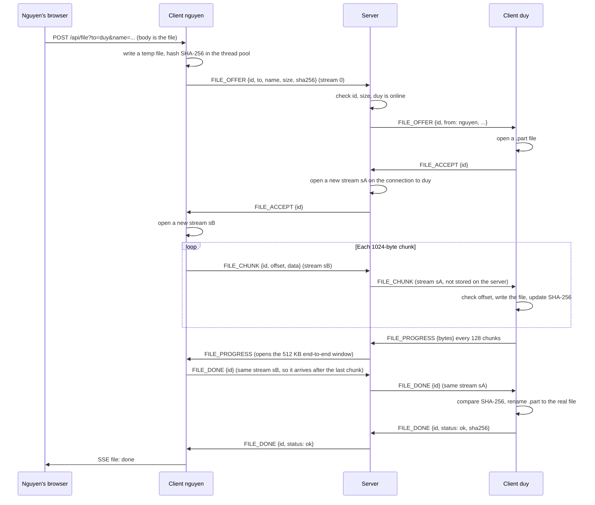
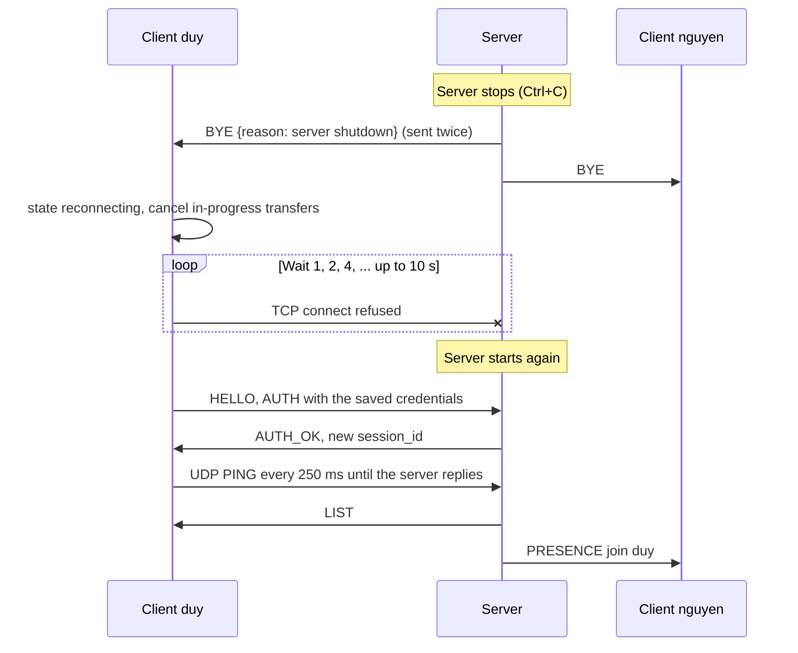

# Technical report: StreamLink

A client-server collaboration application built on a custom reliable protocol over UDP.

| Item | Details |
| --- | --- |
| Course | Network Application Development |
| Language | Python 3.9+ (`asyncio`, standard-library sockets) |
| External libraries | `cryptography` (X25519, HKDF, AES-GCM); `pytest` and `ruff` for tests and formatting |
| Source | `streamlink/` (server, client, protocol, RUDP, crypto), `tools/`, `tests/` |
| Related docs | [README.md](../README.md) (install and run), [PROTOCOL.md](PROTOCOL.md) (full specification) |

## 1. Overview

StreamLink lets users on the same LAN or VPN log in, see who is online, chat in a shared room or privately, and send files to each other. After login, all data travels on UDP. Reliability, ordering, flow control, and congestion control are provided by a custom **RUDP** (Reliable UDP) layer, in the style of QUIC: each data stream has its own sequence numbers, so a lost packet on a file stream does not stall chat.

The table below maps the ten grading steps to the implementation:

| Step | Requirement | Implementation |
| --- | --- | --- |
| 1 | Protocol design | [PROTOCOL.md](PROTOCOL.md): 27-byte header, 20 packet types, 5 flags, state diagrams |
| 2 | TCP handshake | `server/handshake.py`: `HELLO` exchanges X25519 keys and assigns `session_id` and the UDP port |
| 3 | Authentication and state | `server/users.py` (PBKDF2), `server/sessions.py` (username, IP, TCP/UDP ports, join time) |
| 4 | Concurrency | One `asyncio` event loop serves every client; tested with 20 concurrent clients |
| 5 | Streaming routing | `server/router.py`: broadcast, unicast, presence; `transport/rudp.py`: multiple streams |
| 6 | Reliable file transfer | 1 KB chunks, a dedicated stream, writes by offset, SHA-256 check (`server/file_relay.py`, `client/core.py`) |
| 7 | Fault tolerance | Heartbeat, 10 s timeout, retransmission limit, `BYE`, automatic reconnect, garbage packets do not crash the server |
| 8 | Security | AES-256-GCM for every UDP payload and the login packets, header as AAD (`crypto/session.py`) |
| 9 | HTTP + JS interface | Hand-written HTTP/1.1 and Server-Sent Events on sockets (`client/web/http_server.py`), plain JS UI |
| 10 | Tests and code quality | 46 `pytest` tests, a lossy-network proxy, a 20-client load test, clean `ruff`, docstrings |

## 2. System architecture

### 2.1. High-level diagram



The server is a relay: every message and file chunk follows client → server → recipient. Clients do not need each other's addresses and do not have to handle NAT between themselves; the server is the only UDP peer a client talks to.

The browser does not talk to the server directly. Each user runs a client process on their own machine. That process keeps the RUDP connection to the server and also serves a small HTTP server on `127.0.0.1`. The browser sends commands with `fetch` and receives events over Server-Sent Events. That satisfies "client-side JavaScript only" while keeping the whole network protocol in Python.

### 2.2. Layers

The assignment asks for a clear split between network logic, data handling, and the interface. Higher layers call only the layer below:

| Layer | Package | Responsibility |
| --- | --- | --- |
| Interface | `client/web/`, `client/cli.py` | Display and user input. Knows nothing about packets. |
| Application | `client/core.py`, `server/router.py`, `server/file_relay.py` | Login, messages, presence, file transfer. Emits events for the UI. |
| Transport | `transport/` | Reliability, order, fragmentation, windows, congestion, heartbeat. Does not interpret message bodies. |
| Security | `crypto/session.py` | Key exchange, encryption, and authentication of each datagram. |
| Framing | `protocol/` | Binary header (`struct`), constants, JSON encoding, input checks. |

`ClientCore` does not depend on a UI: it publishes every change (messages, user list, file progress, network stats) onto an event queue. The web UI and the CLI are two subscribers of that queue.

### 2.3. Concurrency

Server and client both use asynchronous I/O (`asyncio`) on one thread:

- The **server** has one TCP listening socket for login (`asyncio.start_server`, one coroutine per connection) and **one** UDP socket shared by every client. `Endpoint` reads `session_id` from the header and hands the datagram to the right `Connection`. There is no thread per client, so 20 clients are 20 `Connection` objects in a dictionary.
- **Timers:** `Endpoint` loops every 20 ms and calls `on_tick` on each connection to check RTOs, send heartbeats, and detect dead peers. Delayed ACKs use `loop.call_later`.
- **CPU-heavy work** is moved to a thread pool with `run_in_executor` so it does not block the event loop: PBKDF2 password hashing (100,000 rounds) on the server, and the file SHA-256 before a send on the client.
- **Backpressure:** the file-send coroutine waits (`await conn.wait_writable(...)`) when a stream has more than 256 unacknowledged packets, instead of reading the whole file into memory.

### 2.4. Why both TCP and UDP

TCP is used only for steps 2 and 3: key exchange and login are short exchanges that must succeed, and TCP lets the server know the client can actually connect before a session is granted. The TCP connection closes right after `AUTH_OK`. Everything after that (messages, files, heartbeats) goes over UDP so the protocol can order each stream independently. A single TCP connection cannot do that: TCP delivers one global order and creates head-of-line blocking.

## 3. Protocol

This section summarizes the main points. The full specification (per-message payloads and constants) is in [PROTOCOL.md](PROTOCOL.md).

### 3.1. Packet format

Every packet (TCP and UDP) has a fixed 27-byte big-endian header, packed with `struct.Struct("!HBBBIIIIIH")`:

```
| magic 2 | version 1 | type 1 | flags 1 | session_id 4 | stream_id 4 | seq 4 | ack 4 | sack_bitmap 4 | payload_len 2 |
```

| Field | Meaning |
| --- | --- |
| `magic` | Always `0x534C` ("SL"). A bad magic or `version` is dropped immediately. |
| `type`, `flags` | Packet type and flags (tables 3.2 and 3.3). |
| `session_id` | Assigned by the server in `HELLO`. Used to find the connection and the decryption key. |
| `stream_id`, `seq` | Stream of the packet and its sequence number in that stream, increasing from 0. |
| `ack`, `sack_bitmap` | On `ACK`: the smallest sequence not yet received (cumulative ACK) and a 32-packet bitmap of later packets that have arrived (SACK). |
| `payload_len` | Payload length. On TCP this is the frame length: read 27 header bytes, then exactly `payload_len` bytes. |

On UDP the payload is always `nonce (12) || ciphertext || tag (16)`. A datagram stays under 1200 bytes so IP does not fragment it (Ethernet MTU 1500 minus IP/UDP headers, with room for a VPN). A message longer than 1100 bytes is split into fragments.

### 3.2. Message types

| Group | Types | Reliable |
| --- | --- | --- |
| Transport control | `ACK`, `PING`, `PONG`, `BYE` | No (not retransmitted) |
| Handshake (TCP) | `HELLO`, `AUTH`, `AUTH_OK`, `AUTH_FAIL` | Via TCP |
| Users | `LIST`, `PRESENCE` | Yes |
| Chat | `MSG_ALL` (broadcast), `MSG_DM` (unicast) | Yes |
| Files | `FILE_OFFER`, `FILE_ACCEPT`, `FILE_REJECT`, `FILE_CHUNK`, `FILE_DONE`, `FILE_PROGRESS`, `FILE_CANCEL` | Yes |
| Errors | `ERROR` (recipient offline, bad JSON, ...) | Yes |

Types with code `>= 0x20` are reliable messages and travel on an RUDP stream. Application payloads are UTF-8 JSON, except `FILE_CHUNK`, which uses the binary layout `transfer_id (16) || offset (8) || data (<= 1024)` to avoid base64.

### 3.3. Flags

| Flag | Meaning |
| --- | --- |
| `FIN` | Last fragment of a message. |
| `FRAG` | A middle fragment; another fragment follows. |
| `ACK` | The packet carries acknowledgement fields. |
| `RETX` | The packet is a retransmission (statistics and debugging). |
| `ENC` | The payload is encrypted. |

### 3.4. Connection state



### 3.5. File-transfer state

These are the states the UI shows for each transfer:



From any state, if one side disconnects or the user cancels, the server sends `FILE_CANCEL` to the other side and the transfer becomes `failed`. The receiver deletes the `.part` file.

### 3.6. RUDP

| Mechanism | How it works |
| --- | --- |
| Streams | Stream 0 for control and chat; each file transfer opens a new stream. Order is guaranteed only inside one stream. |
| Send schedule | Stream 0 is always preferred; file streams share the rest round-robin. |
| ACK | Cumulative ACK plus a 32-bit SACK bitmap. Sent immediately on a hole or every 2 packets, otherwise delayed by at most 10 ms. |
| Selective retransmission | Only missing packets: fast retransmit (after 3 later packets are SACKed), RACK-style time-based loss detection, and RTO. |
| RTO | Jacobson/Karels (`SRTT + 4·RTTVAR`), clamped to 200 ms–3 s, doubled on timeout, no RTT sample from a retransmission (Karn). |
| Flow control | Sliding window of 1024 packets per stream; files also have a 512 KB end-to-end window driven by `FILE_PROGRESS`. |
| Congestion control | One `cwnd` for the connection, **CUBIC** by default (with a TCP-friendly region), NewReno optional. |
| Heartbeat | `PING`/`PONG` every 3 s, measures RTT; 10 s of silence closes the connection. |

The three subsections below describe reliability, flow control, and congestion control in `transport/rudp.py` and `transport/congestion.py`. The implementation is enough to run under loss and has its own tests; it is a reduced form of full TCP and QUIC.

#### Reliability

Each stream has a sequence number `seq` that increases from 0. The receiver keeps `expected` (the next packet to deliver) and a buffer for packets that arrive early. A packet is delivered only when `seq` matches `expected`, so the application always sees one stream in order. A duplicate (`seq` already delivered, or already buffered) is dropped, but still triggers an immediate ACK because the previous ACK may have been lost.

The receiver acknowledges with a cumulative ACK: `ack` is the smallest sequence number not yet received. `sack_bitmap` is 32 bits; bit `i` set means packet `ack + 1 + i` has arrived. An ACK is sent immediately on a hole or after every 2 packets; otherwise it is delayed by at most 10 ms.

The sender retransmits only the packets that are still missing, in three ways:

- **Fast retransmit:** a packet is still missing while at least 3 packets with a higher `seq` have been SACKed, and at least 1 RTT has passed since it was last sent.
- **RACK:** a packet sent before a packet that has since been acknowledged, and older than `SRTT + max(SRTT/4, 2 ms)`, is treated as lost. This still works when the window is too small to produce 3 SACKs.
- **RTO:** a packet still unacknowledged after `RTO` is sent again. `RTO = SRTT + 4·RTTVAR`, clamped to 200 ms–3 s, and doubled after each timeout. Karn's rule does not sample RTT from a retransmitted packet.

A packet retransmitted more than 15 times closes the connection. `ACK`, `PING`, `PONG`, and `BYE` do not use this machinery: they are not retransmitted, because losing one copy does not corrupt data (`BYE` is sent twice to be safe).

Limits compared with TCP: SACK covers only the 32 packets immediately after a hole, so a farther hole waits for RACK or RTO; a reconnect creates a new session, so unacknowledged packets from the old session are not resumed.

`tests/test_rudp.py` checks in-order delivery and reassembly, runs with 10% and 20% loss plus reordering and duplicates, and checks that loss on one stream does not block another.

#### Flow control

Flow control stops the sender from overflowing the receiver. There are two levels.

The transport level is a fixed sliding window of **1024 packets per stream**. The receiver drops packets with `seq >= expected + 1024` and counts them in `window_drops`. The sender does not transmit a packet with `seq >= base + 1024`, where `base` is the highest cumulative ACK of the stream. The receiver's reorder buffer therefore stays within 1024 packets per stream.

The application level applies only to file transfer, because the window above controls only one hop. The server forwards a chunk as soon as it arrives, so a slow receiver and a fast sender would grow the server queue without bound. The receiver reports bytes written with `FILE_PROGRESS` every 128 chunks (128 KB). The sender may not run more than **512 KB** ahead of that report; the send coroutine waits until a new report arrives. The report interval (128 KB) is smaller than the window (512 KB), so the receiver always has enough data to report before the sender runs out of window. The send coroutine also waits when a stream has more than 256 unacknowledged packets, so a large file is not read into memory all at once. Every wait has a timeout.

Unlike TCP, the window size is a constant in the code. There is no `rwnd` field for the receiver to advertise a window that shrinks with free memory.

#### Congestion control

Congestion control limits packets in flight on the whole connection, shared by every stream, so the network queue does not fill up. The default is CUBIC; NewReno is selected with `--cc reno`. Both compute `cwnd` in packets.

| Phase | Behavior |
| --- | --- |
| Slow start | `cwnd` starts at 10 and grows by 1 per acknowledged packet, until `ssthresh`. |
| Congestion avoidance | NewReno adds `1/cwnd` per ACK (one packet per RTT). CUBIC follows `W(t) = C·(t − K)³ + W_max` with `C = 0.4`, and never grows slower than the Reno estimate (TCP-friendly region). |
| Loss | CUBIC multiplies `cwnd` by 0.7, NewReno halves it, then sets `ssthresh` to the new window. The window is reduced only once per loss episode. |
| Timeout | `ssthresh` is reduced as above and `cwnd` returns to the floor of 4, then slow start begins again. The floor of 4 keeps enough packets in flight to still produce SACKs. |
| Limits | `cwnd` stays between 4 and 2048 packets. |

On loss, fast retransmit and RACK follow the "Loss" row; a timeout follows the "Timeout" row and doubles the RTO.

This version omits several mechanisms from RFC 8312 and full NewReno: no pacing, PRR (proportional rate reduction), HyStart, or ECN, and Reno does not inflate the window during fast recovery. `cwnd` is counted in packets, not bytes. `tests/test_congestion.py` checks slow start, window reduction, recovery toward `W_max`, and clamping inside the limits.

### 3.7. Security

- **Key exchange:** on each login both sides generate an ephemeral X25519 key pair and exchange it in `HELLO`. The shared secret goes through HKDF-SHA256 (salt is `session_id`, info contains both public keys) to produce two AES-256 keys, one per direction.
- **Encryption:** AES-256-GCM for every UDP payload (including `ACK` and `PING`) and for `AUTH`, `AUTH_OK`, `AUTH_FAIL` on TCP. The password therefore never travels in the clear.
- **Header integrity:** the 27-byte header is additional authenticated data (AAD). An attacker cannot change `seq`, `ack`, or `session_id` without detection. A packet that fails to decrypt is dropped and counted in `decrypt_failures`.
- **Nonce:** a 64-bit counter increases per direction; each retransmission is encrypted again under a new nonce.
- **Password storage:** PBKDF2-HMAC-SHA256, 16-byte salt, 100,000 iterations.

## 4. Sequence diagrams

### 4.1. Life of one chat message

Duy sends a message to the shared room, and one packet is lost on the way to Nguyen:



Main points:

1. The browser only calls the local API; `ClientCore` attaches `cid` so it can later match the server echo.
2. The server echoes the message to the sender. The sender learns that the server received it, and every client displays the same order (the `id` assigned by the server).
3. On loss, the receiver holds early packets in the reorder buffer and reports the hole with SACK; the sender retransmits only the missing packet.
4. A direct message (`MSG_DM`) follows the same path, except the router sends it to the recipient and the sender instead of everyone. If the recipient is offline, the server returns `ERROR user_offline`.

### 4.2. One file transfer

Nguyen sends a file to Duy through the web UI:



- File chunks travel on their own stream, so Duy and Nguyen can keep chatting on stream 0 while a file is in progress.
- The server does not write the file to disk. It forwards chunks only for an accepted transfer, and only from the real sender.
- Integrity is checked at two levels: AES-GCM protects each packet, and SHA-256 protects the whole file after the bytes are assembled.

### 4.3. Disconnect and reconnect



If a client is killed without sending `BYE`, the server closes the session after 10 seconds with no packets, tells the others with `PRESENCE leave`, and cancels related file transfers.

## 5. Interface

The web UI has the conversation list and online users on the left, the chat in the middle, and the network panel plus file progress on the right. The screenshots below are from a real demo: one server, three clients (duy, nguyen, carol), with Duy's UDP path going through `lossy_proxy` at 3% loss, 15 ± 5 ms delay, and 1% duplication.

There is also a terminal UI (`python -m streamlink.client cli`) with `/w`, `/send`, `/users`, `/transfers`, `/stats`, and `/quit`.

## 6. Tests and results

### 6.1. Automated tests

46 `pytest` tests finish in about 15 seconds, all passing:

| File | What it checks |
| --- | --- |
| `test_protocol.py` | Header pack and unpack, rejection of bad packets, a fragment that fits one datagram, key exchange, tamper detection, non-repeating nonces |
| `test_congestion.py` | Slow start and window reduction for CUBIC and NewReno, recovery toward `W_max`, window limits |
| `test_rudp.py` | In-order delivery and reassembly; 10% and 20% loss with reordering and duplicates; independent streams (no head-of-line blocking); sliding window; backpressure; garbage packets; dead-peer detection |
| `test_integration.py` | Login, presence, messages; bad password; full server; file integrity from 0 B to 700 KB; file transfer under loss; recipient disappearing mid-transfer; a dead client and garbage packets do not crash the server; reconnect after the server restarts; a second login replaces the old session; the on-wire payload does not leak plaintext |
| `test_web.py` | Hand-written HTTP server: static files, API, SSE, upload, download, cross-origin `POST` blocked by `Origin`, malformed requests |
| `test_load.py` | 20 concurrent clients, on a clean network and with 5% loss |

Lossy-network tests use `tools/lossy_proxy.py`, a UDP proxy that can drop, delay, reorder, and duplicate packets.

### 6.2. 20-client load test

`tools/load_test.py` runs 20 clients; each sends 20 group messages and 20 direct messages, while 5 files of 2 MB are sent in parallel. Results on a MacBook (loopback):

| Scenario | Group delivered | Direct delivered | Median / p95 latency | Files | Retransmit rate |
| --- | --- | --- | --- | --- | --- |
| Clean network | 8000/8000 | 800/800 | 21 / 24 ms | 5/5 SHA-256 match, 10 MB/s | 0% |
| 5% loss, 10 ± 5 ms delay | 8000/8000 | 800/800 | 817 / 1737 ms | 5/5 SHA-256 match (1 MB files) | 2.7% |

No message was lost and every file hash matched. Latency on the clean network is mostly CPU time: the load test runs all 20 clients and the server in **one** Python process, and each group message must be encrypted and sent to 20 people (0.9 ms with 2 clients, 8 ms with 10). Under loss, latency rises because stream 0 delivers chat in order: a lost message holds the messages after it until it is retransmitted. That is the cost of ordered delivery inside one conversation.

### 6.3. Multi-terminal demo on a lossy path

In the section 5 demo, a 6 MB file from Nguyen to Duy through the proxy (3% loss, RTT about 44 ms) reached about 134 KB/s and matched SHA-256. That is consistent with TCP-style congestion control and the Mathis estimate \( \frac{MSS}{RTT} \cdot \frac{1.22}{\sqrt{p}} \approx \frac{1024\,\text{B}}{0.044\,\text{s}} \cdot \frac{1.22}{\sqrt{0.03}} \approx 160\,\text{KB/s} \). On lossless loopback the load test reaches about 10 MB/s.

### 6.4. Bugs found in the final UI check

While taking screenshots, two small bugs showed up and were fixed:

- On reload, the UI rebuilt chat history before it knew the current username, so a message Duy sent to Nguyen landed in a conversation "@ duy". Fix: take the username from the snapshot before rebuilding history (`app.js`).
- After reconnect, the "connected" status event was emitted before the reconnect counter was incremented, so the UI always showed 0. Fix: emit status again after incrementing the counter (`core.py`); `test_client_reconnects_after_server_restart` now checks the event the UI actually receives.

### 6.5. Code quality

- `ruff check` and `ruff format --check` are clean across the tree.
- Every public module and class has a docstring that states its responsibility.
- There is no web framework, WebSocket library, or high-level networking library: HTTP/1.1, SSE, and RUDP are written directly on `asyncio` streams and datagram sockets.

## 7. Difficulties and how they were solved

**Head-of-line blocking between chat and files.** A single sequence space for the whole connection, as in TCP, would queue a chat message behind thousands of file chunks while a large file is sent over a lossy path, and the chat message would wait until every lost file packet was retransmitted. The fix is QUIC-style streams: each stream has its own `seq`, reorder buffer, and ACK; the scheduler always sends stream 0 before sharing turns among file streams. `test_streams_are_independent` checks that loss on one stream does not slow another.

**Packet fragmentation.** A datagram larger than the MTU is fragmented by IP; losing one IP fragment loses the whole datagram, and many VPNs drop IP fragments. Datagrams are therefore limited to 1200 bytes. After the 27-byte header and 28 bytes of AES-GCM, 1145 bytes of data remain, so RUDP splits messages into 1100-byte fragments with `FRAG` and `FIN`, and the receiver delivers a message only when it sees `FIN`. To avoid a memory exhaustion attack, a reassembled message is limited to 1 MB; past that the connection is closed.

**Server buffer growth and deadlock while relaying a file.** The server forwards a chunk as soon as it arrives. If the sender has a good path and the receiver is slow, chunks pile up in the server's send queue and server memory grows without bound. The RUDP sliding window does not fix that, because it only controls one hop. The fix is an **end-to-end** window at the application layer: the receiver reports bytes written with `FILE_PROGRESS` every 128 KB, and the sender may not run more than 512 KB ahead of that number. The report interval (128 KB) must be clearly smaller than the window (512 KB); otherwise the sender waits for a report the receiver does not yet have enough data to send, and the two sides wait on each other forever. Every wait has a timeout (30 seconds for progress, 120 seconds for accept and the final result) so a disappeared peer does not hang the other side.

**`FILE_DONE` arriving before the last chunk.** Separate streams create a new problem: if the sender's `FILE_DONE` traveled on stream 0 with the other control messages, a lost last chunk could be retransmitted after `FILE_DONE` had already arrived, and the receiver would hash an incomplete file and report it as corrupt. The fix is to send the sender's `FILE_DONE` on the **same stream** as the chunks, so stream order guarantees it arrives after the last chunk.

**Congestion window collapse under loss.** With 10–20% loss, the classic timeout response (set `cwnd` back to 1 packet) collapsed throughput. With 1–2 packets in flight there are never 3 SACKs to trigger fast retransmit, so every loss waits for an RTO, the RTO doubles, and throughput falls near zero. Three changes fixed it: keep `cwnd` at a minimum of 4 packets; add RACK-style time-based loss detection (RFC 8985), which treats a packet as lost if a later packet has been acknowledged and `SRTT + SRTT/4` has passed, and which works with a small window; and reduce `cwnd` only once per loss episode. The RTO also has a 200 ms floor, as on Linux, because with a sub-millisecond loopback RTT a tiny RTO causes a spurious retransmission whenever the receiver delays an ACK by 10 ms.

**Nonce on retransmission.** If the nonce were derived from `(stream_id, seq)`, a retransmission would be encrypted a second time under the same nonce and the same key, which is forbidden for AES-GCM (it leaks the XOR of the two plaintexts and allows tag forgery). The fix is a 64-bit counter per direction, and re-encryption on every send. The two directions use different keys, so the client and server counters may take the same numeric value.

**The server does not yet know the client's UDP address.** After TCP, the server knows the IP but not the client's UDP port (and NAT may rewrite that port). A `LIST` sent immediately would have nowhere to go. The client therefore sends `PING` every 250 ms until the first packet from the server arrives. The server records the address from the first valid UDP packet; only then does the session become ACTIVE and other users see this user online. The address is updated only from a packet that decrypted successfully, so a third party cannot steal the session with a forged packet.

**Duplicate login and a reconnect loop.** When the same account logs in a second time, the server closes the old session. If the old session treats that as a network failure and reconnects, it kicks the new session, and the two clients kick each other forever. The server sends reason `replaced`, and a client that sees that reason stops instead of reconnecting.

**HTTP and server push without a framework or WebSocket.** The UI needs messages and file progress in real time. Instead of WebSocket (which the assignment forbids), the gateway returns `text/event-stream` (Server-Sent Events) on a held-open HTTP connection, with a keepalive line every 15 seconds. Requests are parsed by hand (request line, headers, `Content-Length`; `chunked` and headers over 16 KB are rejected). A file upload is read in 256 KB blocks and written straight to disk instead of being buffered in memory. Because the gateway listens on `127.0.0.1`, a malicious page open in the same browser could still `POST` to it; the gateway rejects any `POST` whose `Origin` header does not match `Host`.

## 8. Limits and possible extensions

- **No server authentication:** the X25519 exchange resists passive eavesdropping and does not resist an active man-in-the-middle. A pinned server public key, as in SSH `known_hosts`, would close that gap.
- **The server is the only relay:** the server can read chat contents. End-to-end encryption between two clients would need a key exchange between those clients through the server.
- **One Python thread:** enough for 20 clients on a LAN, limited by CPU as the user count grows. Clients could be split across processes, or encryption and packet scheduling could be rewritten in a compiled language.
- **History is not durable:** messages live only in the client's memory; an offline user does not receive messages sent while they were away.
- **No resume of a partial file:** a disconnect cancels the transfer and it must start over. Chunks already carry `offset` and the receiver keeps the `.part` file, so resume from the last offset is a natural extension.
- **No BBR yet:** CUBIC and NewReno are implemented. BBR needs continuous bandwidth and minimum-RTT estimates and would be a natural extension of `transport/congestion.py`.
